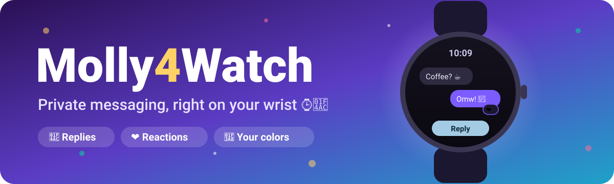
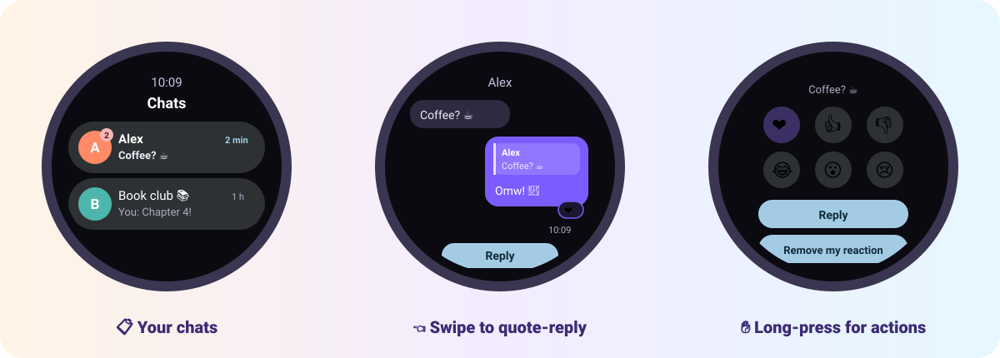
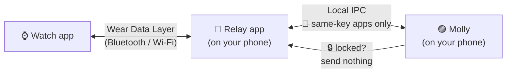

<div align="center">



[](https://github.com/TheWindWalkerX/Molly4Watch/releases/latest)
[](#-requirements)
[](#-requirements)
[](LICENSE)

### Read and answer your Molly chats from your Pixel Watch. No phone in hand. ✨

**[⬇️ Download](https://github.com/TheWindWalkerX/Molly4Watch/releases/latest)** · **[📲 Install guide](docs/INSTALL.md)** · **[🧠 How it works](#-how-it-works)** · **[🛠️ Build it](#%EF%B8%8F-build-it-yourself)**

</div>

---

## 🌟 What it does



| | Feature | |
|:-:|---|---|
| 📋 | **Chat list** | Profile pictures, unread badges, the newest message, "2 min" style times |
| 💬 | **Conversations** | Google Messages vibes: yours on the right in the chat's own color, theirs on the left |
| 👈 | **Swipe to reply** | Swipe a message left to send a *real* quoted reply |
| ❤️ | **Reactions** | Long-press any message: ❤️ 👍 👎 😂 😮 😢, or remove yours |
| 🎙️ | **Reply your way** | Voice, keyboard or emoji, via the watch's own input |
| ✅ | **Mark read** | Clear the unread badge from your wrist |
| 🎨 | **Your colors** | The watch borrows your phone's Material You palette |
| 🔒 | **Lock-aware** | When Molly locks, the watch shows *nothing*. Not even a name. |

## 📦 The three APKs

| APK | Goes on | Job |
|---|---|---|
| 🟣 `…-phone-molly.apk` | 📱 Phone | Molly, plus a tiny, locked-down doorway for the relay |
| 🔵 `…-phone-relay.apk` | 📱 Phone | **Molly Wear relay**: chats with your watch so Molly doesn't have to |
| 🟡 `…-watch.apk` | ⌚ Watch | The watch app you'll actually tap on |

### 🛍️ Prefer F-Droid?

Add the **Molly4Watch repo** to F-Droid (or Droid-ify / Neo Store) for one-tap installs and update notifications for the phone apps:

**[👉 thewindwalkerx.github.io/Molly4Watch-fdroid](https://thewindwalkerx.github.io/Molly4Watch-fdroid/)** · fingerprint `A184441C…F91E628B`

> [!TIP]
> New here? The **[install guide](docs/INSTALL.md)** walks you through it step by step, with pictures-in-words and zero guesswork. 🧭

## 🧠 How it works



- **Molly stays Google-free.** The Wear Data Layer needs Google Play services, so that lives in the separate relay app. Molly only talks to the relay, and only to an app signed with the same key.
- **No data at rest on the watch.** Chats live in memory; the watch app saves nothing.
- **Locked means locked.** If Molly is locked, or the relay can't reach it, the watch gets an empty "locked" screen.
- The gritty details: [`docs/wear/DECISIONS.md`](docs/wear/DECISIONS.md).

## ✅ Requirements

- 📱 **Phone:** Android 8.1+ with Google Play services (GrapheneOS: sandboxed Google Play works) and the **Pixel Watch** app
- ⌚ **Watch:** Wear OS 3+ (tested on a Pixel Watch 3, Android 17)
- 🧰 **For installing:** a computer with `adb`, *or* a file manager on the phone

## 🛠️ Build it yourself

<details>
<summary><b>Click for the builder's corner</b> 🔧</summary>

```sh
git clone https://github.com/TheWindWalkerX/Molly4Watch.git && cd Molly4Watch
# JDK 21 + Android SDK (platform 36.1, build-tools 36.0.0, NDK 28.0.13004108)
./gradlew -PmollyWear.upstreamLibsignal=true :app:assembleProdWebsiteRelease :wear-relay:assembleRelease :wear:assembleRelease
```

- Molly's Maven artifacts are currently unavailable (HTTP 402), so the build uses Signal's official libsignal and a locally repackaged RingRTC. Recipe and provenance: [`docs/wear/DECISIONS.md`](docs/wear/DECISIONS.md) (D3).
- All three apps **must be signed with the same key** (`CI_KEYSTORE_PATH`, `CI_KEYSTORE_ALIAS`, `CI_KEYSTORE_PASSWORD`).
- Tests: `./gradlew :wear-protocol:test :wear-ipc:testDebugUnitTest :wear-bridge:testDebugUnitTest :wear-relay:testDebugUnitTest :wear:testDebugUnitTest`

</details>

## ⚠️ Good to know

> [!WARNING]
> This is an **unofficial** build, not affiliated with or endorsed by the Molly project. It's signed with its **own key**, so it can't update an official Molly install. Switching means **backup → uninstall → install → restore**. The [install guide](docs/INSTALL.md#-already-using-molly) covers it.

> [!NOTE]
> Until Molly's own libsignal is available again, this build uses Signal's official libsignal 0.96.3, which **doesn't include Molly's "proxy-only when a proxy is set" change**. If you rely on Molly's proxy, wait for a later release.

## 💜 Credits

- Built on **[Molly](https://github.com/mollyim/mollyim-android)**, the hardened Signal fork. Molly's own README: [`README-MOLLY.md`](README-MOLLY.md)
- Watch companion by **Cloud Kaffee** ☕
- License: **[AGPL-3.0](LICENSE)**, same as Molly

<div align="center">

Made with ☕ and ⌚ · **[⬇️ Get it](https://github.com/TheWindWalkerX/Molly4Watch/releases/latest)**

</div>
